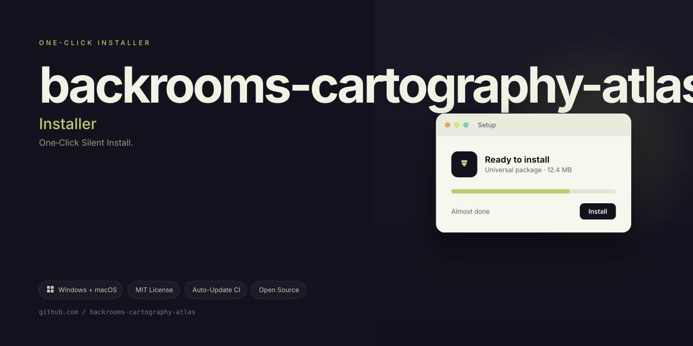
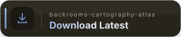

# 🌌 LEXICON OF THE UNSEEN

**A collaborative cartography engine for fictional universes, urban legends, and the liminal spaces between documented reality and collective imagination.**

---

## Overview

Every culture has its hidden geographies — the staircases that lead nowhere, the corridors that exist between floor plans, the cities that appear only in the peripheral vision of tired travelers. The Lexicon of the Unseen is an open-source narrative mapping platform designed to document, visualize, and interconnect these fictional territories with scholarly precision and artistic flair.

Built on the twin pillars of community-driven worldbuilding and cutting-edge graph visualization, this platform transforms scattered folklore, user-submitted anomalies, and interconnected mythologies into a living, navigable atlas. Think of it as a WikiMap for the stories that never made it into the official record — a place where the boundaries between authored fiction and collective hallucination become beautifully, deliberately blurred.

The engine is optimized for **multi-universe concurrency**, meaning you can maintain separate canons, crossover events, and even contradictory timelines without data corruption. Each narrative thread is tagged, timestamped, and weighted according to community consensus, allowing contributors to see which legends are gaining traction and which are fading into obscurity.

---

## ✨ Key Features

### 🗺️ Three-Dimensional Narrative Cartography
Unlike flat wiki pages, entries exist in a **spatial graph environment** where proximity implies thematic connection. Locations that are narratively linked appear adjacent on the map, creating intuitive discovery paths for new readers. Zoom levels range from the macro (entire fictional continents) to the micro (specific rooms within a single structure).

### 🔄 Temporal Layering System
Stories rarely stay static. Each entry supports **versioned timelines**, allowing you to view how a location has evolved across different authors, eras, or retellings. A war-torn plaza in one canon may be a peaceful marketplace in an alternate timeline — both coexist in the same spatial node, separated by a sliding temporal filter.

### 🌐 Polyglot Annotation Engine
The interface and all user-generated content support real-time translation into **twenty-seven languages**, with community-verified glossaries for fictional terms that defy literal translation. A legend born in a Japanese creepypasta forum can be read and expanded upon by a Brazilian urban explorer without losing its original cultural texture.

### 🧠 Entity Relationship Bridge
Every monster, guardian, or spectral resident is cross-referenced with its habitats, origins, and behavioral patterns. The system automatically suggests relationships between seemingly unrelated entities — perhaps the shadowy figure from one legend shares a behavioral trait with a creature from another continent's folklore.

### 📊 Consensus Weighting Algorithm
No single author can dominate the narrative. Each contribution is weighted using a **collaborative filtering metric** that combines community upvotes, citation completeness, and internal consistency checks. Popular, well-sourced entries rise to prominence while speculative additions remain accessible but clearly marked as "unverified transmissions."

### 🕯️ Immersive Reading Mode
Beyond the graph view, a dedicated **narrative mode** renders locations as richly formatted prose documents, complete with ambient audio descriptions and optional first-person perspective. This mode is optimized for long-form reading on any device, from ultrawide monitors to pocket-sized smartphones.

### 🛰️ Offline Exploration Kit
For those who prefer to venture into the unseen without a network connection, the entire map graph can be exported as a **self-contained portable archive**. This archive retains all spatial relationships and metadata while compressing media assets to a size suitable for offline drives.

---

## 🚀 Getting Started

The Lexicon is designed to be immediately accessible, whether you are a Worldbuilder documenting a private universe or a Folklorist cataloging shared urban myths.

**For Readers & Explorers:** The default landing view is a curated "signal map" highlighting new or recently active locations. You can begin exploring immediately without any configuration — the core graph is pre-populated with a sample universe to demonstrate the platform's capabilities.

**For Contributors:** To begin adding your own locations, entities, or narrative fragments, you will need to create a community profile. This requires only an email address and a chosen pseudonym. After verification, you gain access to the spatial editor, a drag-and-drop interface that allows you to place new nodes on the map and connect them to existing ones.

**For Server Administrators:** The platform supports both cloud-hosted and self-managed deployments. The architecture follows a modular micro-service pattern, allowing you to enable only the components you need — from the full collaborative suite to a read-only public archive. Comprehensive configuration guides are provided within the deployment package.

The software runs on any modern web runtime with JavaScript enabled. No native installation is required for end users, and the backend can be provisioned on standard virtual private servers or container orchestration platforms.

---

## 🧩 Architecture & Technology

The Lexicon of the Unseen is built on a **federated graph database** that prioritizes relationship integrity over raw storage capacity. The front-end uses a reactive component library to render thousands of nodes with sixty frames-per-second smoothness, even on mid-range hardware.

### Core Stack Components
- **Reactive User Interface:** Built with modern web standards, ensuring compatibility across all major browsers without proprietary plugins.
- **Graph Visualization Layer:** Utilizes advanced canvas rendering techniques for displaying complex node networks with minimal memory overhead.
- **Real-time Synchronization Engine:** WebSocket-based connection allows multiple contributors to view and edit the same spatial region simultaneously, with conflict resolution resolved via a temporal ordering algorithm.
- **Semantic Search Index:** Full-text and vector-based search over all narrative content, multilingual by default, supporting fuzzy matching for partially remembered legends.

### Data Portability
All data is stored in an open, documented schema. Export functionality allows users to migrate their entire universe to other formats, including standard graph exchange languages and plain-text archives. We believe your fictional worlds should never be locked into a proprietary format.

---

## 🛣️ Roadmap for the Unseen

The following features are currently in active development or high-priority planning stages for the 2026 release cycle:

### 🎙️ Audio Narrative Synthesis
An integration that will automatically generate ambient soundscapes for each location based on its tags and description. A storm-battered lighthouse will produce the sound of crashing waves and groaning metal, while a silent library will offer just the faint rustle of turning pages.

### 🤝 Cross-Universe Interoperability Protocol
A standardized API that will allow different Lexicon instances to share select portions of their maps, enabling complex crossover events between distinct fictional universes. This will be entirely opt-in, with granular privacy controls per node.

### 📜 Historical Revision Sandbox
A dedicated environment for exploring "what-if" scenarios. Users can fork the entire map at a specific point in its history, apply massive changes, and observe how the narrative network re-balances around the alteration.

### 🔮 Predictive Legend Evolution Model
An experimental feature using statistical analysis to predict which newly submitted locations are likely to gain popularity, based on patterns observed in the successful legends of the past decade.

### 🧭 Mobile AR Implementation
A companion application that will overlay the Lexicon graph onto the physical world using augmented reality, allowing urban explorers to place fictional locations onto real-world geographies for location-aware storytelling.

---

## 🌍 Community Guidelines & Etiquette

The Lexicon of the Unseen is a shared dream — and like any dream, it requires a sense of mutual respect to remain coherent.

Contributors are expected to **respect canonical continuity** unless explicitly working in a marked parallel universe. When adding to an existing location, it is considered courteous to review its temporal history and align with the established tone.

Disagreements about narrative direction are resolved through the **Consensus Weighting Algorithm** rather than argumentation. Downvoting a contribution is permitted, but you must provide a constructive note explaining your reasoning, which will be visible to the original author.

**Zero tolerance is enforced for:**
- Attempts to insert real-world personal information into fictional entries.
- Harassment of contributors based on their narrative choices.
- Deliberate vandalism of well-established canonical nodes.

The moderation team operates on a rotating basis from trusted community members, overseen by the core maintainers.

---

## 🤝 Contributing to the Cartography

This project thrives on diverse perspectives. If you possess skills in **spatial interface design**, **multilingual translation**, **narrative theory**, or **data visualization**, your contributions are most welcome.

Contribution processes are documented extensively in the `CONTRIBUTING` guide. In summary:
- Fork the project workspace to create your own sandboxed environment.
- Propose changes via a structured request that includes a narrative rationale.
- For significant structural changes, a community vote is triggered.
- All code contributions undergo a review process focusing on security, performance, and accessibility.

Beyond technical contributions, the most valuable contribution is always **the documentation of a new place**. If you have dreamed of a corridor that repeats, a city beneath the sea, or a forest that remembers — we invite you to give it coordinates on our map.

---

## ⚠️ Important Disclaimers

### ✋ Fictional Content Notice
All content within this platform is **entirely fictional** unless explicitly tagged otherwise. Any resemblance to real locations, living or deceased persons, or actual events is purely coincidental. This platform is designed for artistic expression, entertainment, and academic study of narrative structures.

### 🛡️ Intellectual Property
You retain ownership of the narrative content you submit. By contributing to the Lexicon, you grant the community a perpetual, non-exclusive license to display, modify, and redistribute your contributions within the platform, ensuring the map remains a living and collaborative work.

### 📡 Data Privacy
Your account metadata (email, pseudonym) is stored securely and is never sold or shared with third parties. Public narrative content is, by nature, public. However, private worlds can be created with restricted visibility, viewable only by whitelisted contributors.

### 🔞 Content Moderation
While the platform encourages exploration of dark or unsettling themes suitable for the horror and mystery genres, explicit sexual content, gratuitous violence against real-world groups, or content promoting real-world harm is strictly prohibited. The moderation team reserves the right to remove entries violating this policy without prior notice.

### 🧭 Reliability of Information
As this is a platform for **fictional cartography**, the platform provides no warranty on the accuracy of any information presented. Exploring fictional dangerous locations does not carry real-world risk, but users are reminded that the platform is not a substitute for professional mental health services if they find certain themes distressing.

---

## 📜 License

This project is released under the **MIT License**, a permissive open-source license that allows for commercial and private use, modification, distribution, and private use of the codebase. This license ensures that the technology behind the Lexicon remains accessible to all who wish to build upon it, while the narrative content remains under the individual ownership of its contributors as detailed in the Disclaimer section above.

You are free to adapt this software to power your own narrative cartography projects, whether for a personal writing hobby or a large-scale commercial storytelling platform.

For the full legal text, please see the [LICENSE](https://opensource.org/licenses/MIT) file included in this repository.

---

## 📬 Contact & Support

For technical issues, feature requests, or community coordination, please explore the repository's issue tracker — it is monitored daily by core maintainers.

For security vulnerabilities, please use the dedicated security reporting channel, and refrain from disclosing potential exploits publicly until a patch has been issued.

General inquiries can be directed to the community forum, where both maintainers and seasoned contributors are happy to assist newcomers in finding their way around the map.

---

## 🗝️ Final Transmission

The Lexicon of the Unseen is more than a software project; it is an invitation. It is a collective acknowledgment that the world we see is not all that exists — that there are corners of the mind and culture that yearn for documentation. By lending your imagination to this map, you become part of a tradition that is as old as storytelling itself: the tradition of marking the unknown.

So, sharpen your digital compass. Check your narrative provisions. And take the first step into the corridor that should not exist.

We will be waiting for you on the other side of the map.